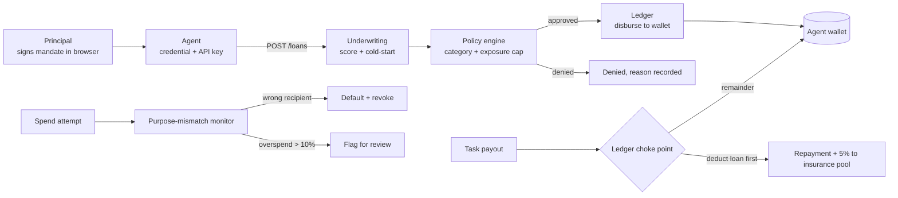
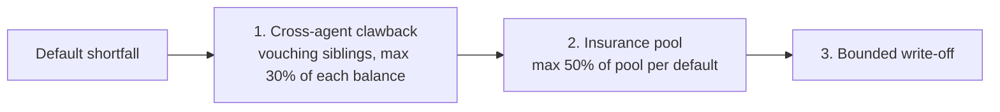

# Credit for Autonomous Agents

**Short-term credit for AI agents that have no legal identity, no credit history, and no collateral.**

Every agent is bound to an accountable human by a signed credential, underwritten on behavior instead of a credit score, and repaid at the ledger layer *before* funds ever reach the agent.

[Live demo](https://credit-for-autonomous-agents-six.vercel.app) · [API docs](https://credit-for-autonomous-agents.onrender.com/docs) · [How it works](#how-it-works) · [Run it locally](#quickstart)

`FastAPI` · `PostgreSQL` · `SQLAlchemy 2` · `Alembic` · `Ed25519` · `Next.js` · `TypeScript`

🏆 1st place, HackZen'26 (Sri Krishna College of Engineering and Technology)

---

## The problem

Every lending system assumes a human on the other side: a legal identity, a credit file, a contract that can be enforced. Autonomous agents that earn money by completing paid tasks have none of these, so they are shut out of credit even when they could repay it. Lenders, in turn, have no way to answer the two questions that matter: *who is accountable if this agent defaults?* and *how do I price risk on something with no history?*

## The idea

CAA replaces the missing human infrastructure with three verifiable substitutes:

| Missing thing | What CAA uses instead |
|---|---|
| Legal identity | An **Ed25519-signed delegation credential** binding the agent to an accountable human principal, re-verified on every request |
| Credit history | A **behavioral score** from task success, spend regularity and repayment history, with a confidence adjustment for thin data |
| Enforceable contract | **Ledger-enforced repayment**: the loan is deducted from inflows before the agent can touch the money |

Losses are bounded in layers: the defaulting agent's own fleet pays first, then a shared insurance pool, and only the remainder is written off.

---

## How it works



### 1. Identity: delegation credentials

The principal generates an Ed25519 keypair **in the browser**; the private key never reaches the server. The principal signs a canonical JSON mandate containing `principal_id`, `agent_id`, the bounds of authorization and an `issued_at` timestamp. That makes the signature a substantive commitment, not just an identifier: only this principal's key could have authorized exactly this agent, with exactly these bounds, at exactly this time.

Credential validity is checked on **every** agent request, and both conditions must hold:

1. `agent.status == active` (this is what revocation flips instantly), and
2. the stored mandate still verifies cryptographically against the principal's public key.

Agents also authenticate with a per-agent bearer API key, stored only as an HMAC-SHA256 hash. Agents that predate the key fail closed.

### 2. Underwriting: behavior, not a credit score

```
raw   = 0.35 × task_success + 0.15 × spend_regularity + 0.50 × repayment_history
score = confidence × raw + (1 − confidence) × 40        # confidence = min(records / 20, 1)
if resolved_repayment_ratio < 0.50:  score = min(score, 40)   # hard gate
```

- **Task success** is the share of successful tasks. No history reads as a neutral 50, not 0.
- **Spend regularity** uses median absolute deviation on amounts (40%) and timing (60%), so one outlier doesn't wreck the score. Under 5 records it stays neutral.
- **Repayment history** is the share of resolved loans that were repaid. It dominates because it is the signal a lender cares about most.
- **The confidence multiplier** stops an agent with two lucky data points scoring like a proven one.
- **The repayment hard gate** ensures an agent that performs tasks well but keeps defaulting never reads as trustworthy.

**Cold start.** An agent with no task history gets a flat **$50 starter limit**, never a percentage of the lender's cap. Principals can opt agents into a *vouching pool*: a new agent gets a score boost from sibling agents under the same principal, hard-capped at **+15**, and only until it has its own history.

### 3. Policy engine

Underwriting asks "is this agent creditworthy?" The policy engine asks "does this loan fit the lender's rules?" and can still say no: allowed task categories, per-agent exposure limit, minimum score, and a **platform-wide exposure cap** across all of a lender's agents. Lenders can also set a manual per-agent credit limit, applied as a final clamp that never changes whether a loan is approved.

### 4. Repayment: one choke point

All changes to `Wallet.spendable_balance` go through `ledger_service`. When money lands for an agent, the open loan is deducted first and only the remainder is released. A partial repayment is **not** a default; default is an explicit trigger (task failure, unauthorized payment). One open loan per agent is enforced at request time.

### 5. Monitoring: purpose-mismatch, not spend volume

Spending a loan quickly is the loan working as intended. The real risk signal is money going somewhere it wasn't borrowed for.

| Signal | Response |
|---|---|
| Payment to a recipient the loan was **not approved for** | Immediate default and revocation |
| Right recipient, amount exceeds principal by **more than 10%** | Flagged to the anomaly feed, no auto-kill |

### 6. Loss containment



The pool is funded by a 5% skim on every successful repayment deduction, like a loan-loss reserve. Both caps exist so one bad default can never drain a healthy sibling or the whole pool.

---

## Features at a glance

- Ed25519 delegation credentials with browser-side key custody and per-request re-verification
- Per-agent API keys, hashed with HMAC-SHA256
- Behavioral scoring with MAD-based regularity, confidence weighting and a repayment gate
- Cold-start handling with capped cross-agent reputation sharing
- Lender policy engine with per-agent and platform-wide exposure caps
- Ledger-enforced repayment, with every money movement recorded as a typed transaction
- Layered loss containment: clawback, insurance pool, write-off
- Instant revocation by principal, automatic trigger, or operator kill switch
- Every decision persists its score and policy threshold *at decision time*, so it stays auditable later
- CSV import of pre-platform task history, validated all-or-nothing
- Three roles with separate UIs: principal, lender, operator
- Scripted end-to-end demo personas

---

## Architecture

```
.
├── backend/                      FastAPI service
│   ├── app/
│   │   ├── main.py               app entrypoint, router registration
│   │   ├── models.py             SQLAlchemy models
│   │   ├── schemas.py            Pydantic request/response models
│   │   ├── dependencies.py       credential validation, auth, revoke_agent()
│   │   ├── routers/              auth, agents, loans, repayment, lenders, admin
│   │   └── services/
│   │       ├── credential_service.py     Ed25519 signing/verification, API-key hashing (no DB access)
│   │       ├── underwriting_service.py   score formula, cold start, sibling boost
│   │       ├── policy_engine.py          category fit, platform exposure cap
│   │       ├── ledger_service.py         wallet ledger, repayment, default waterfall
│   │       ├── monitoring_service.py     purpose-mismatch detection
│   │       ├── csv_import_service.py     task-history CSV validation
│   │       └── auth_service.py           password hashing, JWT
│   ├── alembic/versions/         10 sequential migrations
│   ├── personas/                 scripted demo scenarios
│   └── tests/
└── credit-app/                   Next.js frontend (principal / lender / operator)
```

Design rules the code follows:

- **`credential_service` has no database access.** It only proves "this exact payload was signed by this key." Whether a credential is *currently usable* is a separate, DB-aware concern in `dependencies.py`.
- **One function flips agent status.** `revoke_agent()` is the only place an agent moves to revoked, defaulted or blacklisted, whether the trigger is monitoring, a task failure, or an operator.
- **Services return raw dataclasses**, not Pydantic schemas, so underwriting and policy logic stay independently testable.
- **Verified and unverified data are separate tables.** `Transaction` is ledger-verified money movement. `TaskRecord` is principal-attested, unverified imported history. They are never conflated.

### Data model

`Principal` → `Agent` → `Wallet` · `Loan` · `Transaction` · `AgentScore` · `Event` · `TaskRecord`, plus `Lender` (policy) and a single-row `InsurancePool`.

---

## Quickstart

### Backend

```bash
git clone https://github.com/DarshanS-Dev/Credit-for-Autonomous-Agents.git
cd Credit-for-Autonomous-Agents/backend

python -m venv venv && source venv/bin/activate      # Windows: venv\Scripts\activate
pip install -r requirements.txt

cp .env.example .env                                  # then edit values
alembic upgrade head
uvicorn app.main:app --reload
```

API at `http://localhost:8000`, interactive docs at `/docs`.

| Variable | Purpose | Default |
|---|---|---|
| `DATABASE_URL` | PostgreSQL connection string | required |
| `JWT_SECRET_KEY` | Signs session JWTs | required |
| `JWT_ALGORITHM` | JWT algorithm | `HS256` |
| `JWT_EXPIRE_MINUTES` | Session lifetime | `60` |
| `AGENT_API_KEY_PEPPER` | HMAC pepper for agent API keys | falls back to `JWT_SECRET_KEY` |
| `ENVIRONMENT` / `DEBUG` | Deployment label / debug mode | `development` / `true` |

### Frontend

```bash
cd credit-app
npm install
BACKEND_URL=http://localhost:8000 npm run dev
```

The frontend proxies every `/api/*` call to `BACKEND_URL` through a Next.js rewrite, so the browser only talks to its own origin.

### Run the demo scenarios

Three scripted personas drive the full API like a real client:

```bash
python -m personas.persona_established     # clean history, loan, repayment
python -m personas.persona_new             # cold-start path, starter limit
python -m personas.persona_misbehaving     # loan, unauthorized spend, default, containment
```

Or trigger one server-side with a single request:

```bash
curl -X POST http://localhost:8000/operator/persona-trigger \
  -H "Content-Type: application/json" \
  -d '{"persona": "misbehaving"}'
```

Set `API_BASE_URL` if the server is not on `http://localhost:8000`.

---

## API overview

Full schemas live at `/docs`. Agent-facing money endpoints (loan request, inflow, spend check, task failure) require a valid credential and the agent's API key.

| Area | Endpoints |
|---|---|
| **Auth** | `POST /auth/signup` · `POST /auth/login` |
| **Agents** | `POST /agents` · `POST /agents/{id}/mandate` · `GET /agents` · `GET /agents/{id}` · `GET /agents/{id}/wallet` · `GET /agents/{id}/score` · `GET /agents/{id}/transactions` · `POST /agents/{id}/revoke` · `POST /agents/{id}/upload-history` |
| **Lender views** | `GET /agents/{id}/lender-view` · `PUT /agents/{id}/credit-limit` |
| **Loans** | `POST /loans/{agent_id}` · `GET /loans/{id}` · `GET /loans` |
| **Repayment** | `POST /repayment/inflow/{agent_id}` · `POST /repayment/spend/{agent_id}` · `POST /repayment/task-failure/{agent_id}` |
| **Lenders** | `PUT /lenders/policy` · `GET /lenders/me` · `GET /lenders/exposure` · `GET /lenders/agents` · `GET /lenders/directory` · `GET /lenders/insurance-pool` |
| **Operator** | `GET /operator/events` · `POST /operator/agents/{id}/revoke` · `POST /operator/persona-trigger` |

---

## Tunable constants

| Constant | Value | Where |
|---|---|---|
| Cold-start limit / base score | $50 / 40 | `underwriting_service` |
| Score weights (task / spend / repayment) | 0.35 / 0.15 / 0.50 | `underwriting_service` |
| Full-trust record count | 20 | `underwriting_service` |
| Max sibling boost | +15 | `underwriting_service` |
| Repayment gate | ratio < 0.50 → score ≤ 40 | `underwriting_service` |
| Clawback cap | 30% of each sibling's balance | `ledger_service` |
| Insurance skim / payout cap | 5% of repayments / 50% of pool per default | `ledger_service` |
| Overspend tolerance | 10% over principal | `monitoring_service` |

---

## Scope and honest limitations

This is a working prototype of the credit logic, not a production lender. Being explicit about the edges:

- **Payments are simulated.** There is no real payment rail or KYC. Inflows are posted through an endpoint; the ledger logic is real, the money is not.
- **Imported history is self-attested.** The score is derived from principal-uploaded CSV task history, which the platform cannot verify. A production system would source this from verified payment or task-platform data.
- **Interest is not priced yet.** `Loan.interest_amount` exists but is always zero.
- **No push updates.** The operator feed is polling (`GET /operator/events`); a WebSocket handler is a placeholder.
- **Single-lender flows.** Multi-lender marketplace bidding is out of scope.
- **Demo-grade hardening.** CORS is open and `DEBUG` defaults to on; tighten both before any real deployment.

### Roadmap

- [ ] Risk-tiered interest at decision time
- [ ] Two-strike "cooling-off" status before blacklisting
- [ ] Task-type risk weighting on limits
- [ ] WebSocket live feed
- [ ] Verified task-history ingestion instead of CSV attestation
- [ ] Explainability and appeal flow for denials

---
